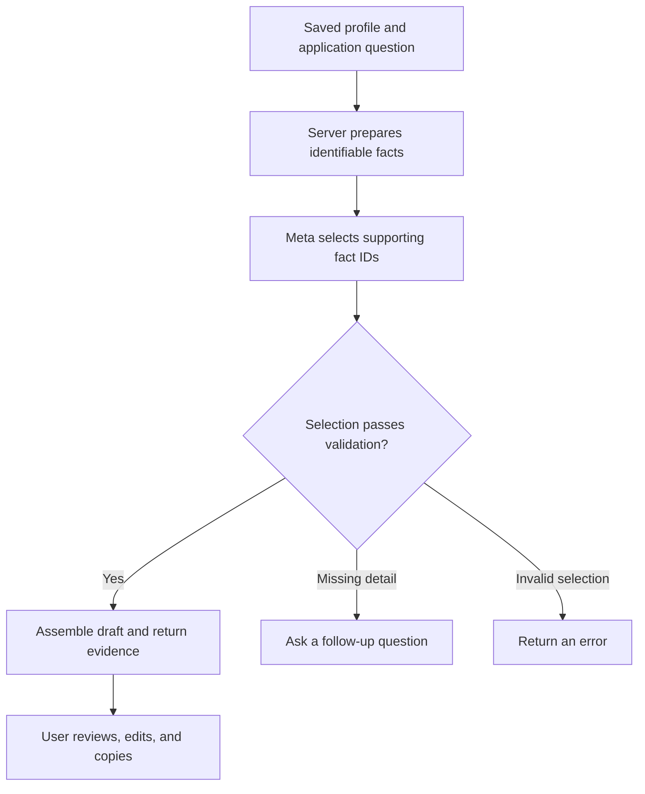

<div align="center">

# ApplyReady

### Tell your story once. Prepare your next application with evidence.

A voice-friendly workspace for internship applicants.<br />
Capture your experience, prepare editable answers, and see the facts behind each draft.

[**Try the live app →**](https://production.d2aibf1anwfl5.amplifyapp.com) · [Explore the code](https://github.com/aditya052003/applyready) · [Run locally](#run-locally)


**Built for the Wispr Flow No Hands Challenge**

</div>

---

## The problem

Applying for internships often means explaining the same projects repeatedly. Each form asks a slightly different question, and useful details get scattered across resumes, notes, and previous answers.

Writing a convincing response is only part of the work. Applicants also need to check that every claim matches what they actually did.

**ApplyReady brings the experience, question, draft, and supporting facts into one workspace.**

## Try it in a minute

1. Open **[ApplyReady](https://production.d2aibf1anwfl5.amplifyapp.com)**. No account is required.
2. Keep the clearly labeled sample profile for a quick demonstration.
3. Go to **New application** and enter: **“Describe a project you built.”**
4. Open **Review answer** and click **Generate answer**.
5. Compare the draft with **Exact profile facts used when generated** below it.

> **Trying it for your own application?** Replace the sample profile and job details first. Sample projects, names, and performance numbers are fictional demonstration content.

## What you can do

| Step | What happens | Why it helps |
| --- | --- | --- |
| **01 · My profile** | Save education, experience, projects, and skills. Use Wispr Flow to dictate into text fields. | Keep reusable facts in one place. |
| **02 · New application** | Add the company, role, job description, and application questions. | Give each answer a specific context. |
| **03 · Review answer** | Generate a draft, inspect the supporting facts, edit, and copy. | Review the evidence alongside the wording. |
| **04 · Submission checklist** | Track proofreading, fact checks, attachments, and other preparation steps. | Keep the final review organized. |

**You remain in control.** ApplyReady prepares responses; it does not submit applications to employers.

## The key design decision: select facts, then assemble the answer

The AI is used to select relevant evidence from the saved profile. The server then builds the initial draft from those exact facts.

This separates choosing relevant information from writing personal claims.



- **Traceable evidence:** the response includes the selected facts and their labels.
- **No unknown fact IDs:** selections must refer to facts supplied by the server.
- **Source consistency:** validation prevents incompatible experiences from being combined into one account.
- **Follow-up support:** missing personal details can trigger a question instead of a completed draft.
- **Editable output:** the applicant can revise the answer before using it.

> Evidence shows where the generated text came from. It does **not** independently verify the truth of the profile. Users must also check any new claims they add while editing.

### A concrete example

For a fictional test profile:

| Saved field | Value |
| --- | --- |
| Project | Demo Task API |
| Contribution | I built endpoints to create and list tasks. |
| Tools | Node.js, Express |

**Question:** “Describe a backend project you built.”

**Generated draft:**

> A relevant project is Demo Task API. I built endpoints to create and list tasks. Tools and skills I used: Node.js, Express.

The API returned those same three facts as evidence. This example was tested against the deployed backend.

## Where Wispr Flow fits

ApplyReady is designed around a simple voice-friendly workflow: **speak about your experience, save the facts, and reuse them when preparing an answer.**

Wispr Flow works as the external dictation tool for entering text into the workspace. The same dictation workflow can be used to communicate requirements and refinements to a coding assistant during development.

| Tool | Responsibility |
| --- | --- |
| **Wispr Flow** | Converts spoken input into text in the user's focused field. |
| **ApplyReady** | Organizes profile facts, application questions, drafts, and review steps. |
| **Meta Model API** | Selects relevant fact IDs for the application question. |
| **Applicant** | Checks accuracy, edits the answer, and submits through the employer's own process. |

ApplyReady does not contain a built-in Wispr SDK or microphone recorder. Its text fields work with Wispr Flow's desktop dictation. The challenge demo and Wispr usage card document the creator's actual voice use separately.

## What has been tested

| Check | Observed result |
| --- | --- |
| Automated generation suite | **7 tests passed** in the reported local run. |
| Production frontend build | `npm.cmd run build` completed successfully. |
| Deployed API | Returned a draft and supporting evidence for the fictional Demo Task API profile. |
| Public website | Generated an answer and displayed evidence using the labeled starter profile. |

The automated suite covers draft assembly, missing-information follow-ups, user-provided follow-up details, invalid fact IDs, the Meta request contract, missing configuration, and the Express generation route with a mock selector.

**These are functional checks, not a benchmark of answer quality or measured time savings.**

## Architecture

| Layer | Implementation |
| --- | --- |
| Interface | React, Vite, Tailwind CSS, Lucide icons |
| Profile and draft storage | Browser localStorage |
| Backend | Node.js and Express |
| AI selection | Meta Responses API with a structured JSON schema |
| Frontend hosting | AWS Amplify Hosting |
| Backend hosting | AWS Lambda and API Gateway HTTP API |
| Deployment definition | AWS SAM |

The browser calls the API, and the server makes the provider request. **The Meta API key belongs on the server and is never a frontend build variable.**

## Privacy and current limits

- Profiles, drafts, and checklist state are saved in the current browser. There is no account system or database synchronization.
- Different addresses—such as a local development URL and the public Amplify URL—have separate browser storage.
- Generating an answer sends profile facts and application context to the backend and onward to Meta when a provider call is needed. Browser storage does not make generation an offline operation.
- Saved facts may still be inaccurate. Evidence citations establish provenance, not independent verification.
- Drafts prioritize traceability and may read mechanically. Human review is part of the workflow.
- AI generation requires a configured provider key, available quota, and a working network connection.
- The demo API has gateway throttling but no per-user authentication. It is a demonstration deployment, not a complete production access-control system.
- The submission checklist is a reminder list; it does not attach files or send applications.

## Run locally

Use **Node.js 22** and npm. The commands below are for Windows PowerShell; `npm.cmd` avoids the PowerShell script-execution-policy issue.

### 1. Clone and install

```powershell
git clone https://github.com/aditya052003/applyready.git
cd applyready
npm.cmd ci
```

### 2. Configure the server

Create `.env` only if it does not already exist:

```powershell
if (-not (Test-Path .env)) { Copy-Item .env.example .env }
notepad .env
```

Set these values locally:

```dotenv
AI_PROVIDER=meta
AI_MODEL=muse-spark-1.3
MODEL_API_KEY=your-meta-api-key
```

Replace the placeholder with your own key. Keep `.env` out of Git. The model is configurable through `AI_MODEL`.

### 3. Start the app

```powershell
npm.cmd run dev
```

Open the Vite URL printed in the terminal, normally `http://127.0.0.1:5173`. If that port is occupied, Vite may choose another one. The API listens on `http://127.0.0.1:8787`.

The Vite development proxy forwards `/api` requests to the local backend. Profile editing remains available without an API key; generation requires configuration.

### 4. Run checks

```powershell
npm.cmd test
npm.cmd run build
```

The automated tests use test doubles rather than live AI requests. Passing them does not confirm live provider access.

## Deployment notes

The deployed frontend and backend are separate:

1. **Backend:** AWS SAM packages the Express Lambda handler from `.deploy/api/`, as defined in `template.yaml`.
2. **Secret:** configure `MODEL_API_KEY` on the Lambda backend. Do not commit it or embed it in frontend code.
3. **Frontend:** set `VITE_API_BASE_URL` to the deployed API base URL **before** running the Vite build.
4. **Hosting:** upload the contents of `dist/` to Amplify, with `index.html` at the archive root and forward slashes in ZIP entry paths.
5. **CORS:** set the SAM `FrontendOrigin` parameter to the exact Amplify site origin.

For example, a frontend build in PowerShell uses:

```powershell
$env:VITE_API_BASE_URL="https://YOUR-API-ID.execute-api.ap-south-1.amazonaws.com"
npm.cmd run build
```

`VITE_API_BASE_URL` is a public endpoint address, not a secret. Changing it requires a new frontend build and deployment.

The current Amplify site uses manual deployment. Pushing to GitHub alone does not update that deployment. Backend source changes must also be copied into the SAM staging folder before rebuilding.

<details>
<summary><strong>Source map</strong></summary>

| Path | Purpose |
| --- | --- |
| `src/App.jsx` | Profile, application, answer review, and checklist interface |
| `src/styles.css` | Application styles |
| `server/app.js` | Express API and request validation |
| `server/grounding.js` | Fact preparation, selection validation, draft assembly, and evidence |
| `server/meta.js` | Meta request and response handling |
| `server/index.js` | Local server entry point |
| `server/lambda.js` | AWS Lambda adapter |
| `test/generation.test.js` | Automated generation tests |
| `template.yaml` | AWS SAM infrastructure definition |
| `.env.example` | Configuration example without real credentials |

</details>

## Next improvements

- Export and import profiles so users can move between browsers.
- Make demo-data setup and clearing more explicit.
- Add authenticated access and stronger abuse controls for wider use.
- Expand independent tests for relevance, missing details, and source consistency.
- Improve draft readability while preserving clear evidence links.

---

<div align="center">

**Built by [Aditya Raut](https://github.com/aditya052003)**

For students who want their application answers to reflect what they actually built.

[**Open ApplyReady →**](https://production.d2aibf1anwfl5.amplifyapp.com)

</div>
